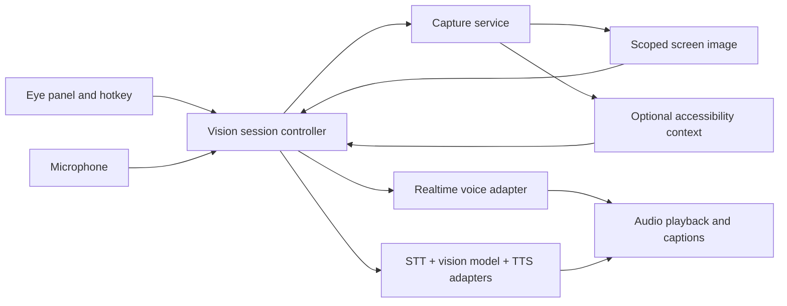

# Ducky Vision: screen-aware voice assistant

Planning baseline: 5 November 2026. Status: proposal; no feature code implemented.

## Product goal

Press the eye in Ducky's floating pill, choose what Ducky can see, and talk about it. For example, open Wikipedia in Zen, point at a diagram, ask “Why does this curve rise here?”, hear an explanation, and ask a follow-up without leaving the page.

Recommended first scope: macOS, one chosen window or screen region, OpenAI API-key authentication, spoken answers and visible captions. Build the capture and provider boundaries so Windows, Linux, other vision providers, and ElevenLabs can follow. These are proposed defaults, not requirements supplied by the user.

The initial assistant observes and explains. Clicking, typing, scrolling, or operating other applications is a separate future capability with its own user controls and execution boundary.

## 1. The architectural decision

Use **visual snapshots plus optional structured context**. Screen capture remains necessary for diagrams, images, layout, and canvas content. Accessibility APIs add useful text, roles, bounds, selection, and notifications, but the information depends on what each application exposes. They are complementary inputs, not interchangeable techniques. Apple's [ScreenCaptureKit](https://developer.apple.com/documentation/screencapturekit) and [AXUIElement](https://developer.apple.com/documentation/applicationservices/axuielement) provide these distinct surfaces.

“Computer use” does not automatically give a model access to the local operating system. Ducky must capture observations, send them to the provider, and implement any tools it offers. OpenAI's [computer-use guide](https://developers.openai.com/api/docs/guides/tools-computer-use) includes screenshot-based workflows and application-provided browser/desktop tools. Explaining the current screen only requires image understanding and conversation.

Avoid a continuous high-frame-rate upload as the default. Capture locally and send a fresh, readable frame for each question; later add bounded refreshes when the selected content changes. A local capture stream and remote model image requests are separate decisions.

Optional browser integration can add the current page's text, selection, and diagram descriptions. An Electron app cannot read Zen's DOM directly merely because both applications are on the same computer. Investigate a user-installed extension if accessibility proves insufficient; do not make it a prerequisite for the first version.

## 2. Interaction design

1. Clicking the eye opens a compact Vision panel attached to the pill.
2. On first use, explain which provider receives screen content, then request screen-capture permission and microphone permission as needed. Ask for accessibility access only when enabling structured context.
3. Choose a source: a specific window, a display, or a rectangular region. Show a local preview and the selected source name. Prefer a window/region over all displays by default.
4. Offer “Talk” and a typed question. Initially use explicit push-to-talk or click-to-talk; add hands-free conversation after turn-taking and echo behavior work reliably.
5. Freeze a reference frame when the question begins. Let the user select a region or point at an area so “this diagram” has a clear referent. Capture pointer position without requiring an agent to move it.
6. Stream the answer as speech with captions. Keep explanations brief initially, with follow-ups such as “go deeper” or “explain the arrow on the left.”
7. An active eye and source label show that Vision is on. Provide separate microphone mute, speech mute, pause capture, change source, and end-session controls.
8. Ending the session closes capture tracks, network connections, audio input/output, pending synthesis, and subscriptions. Handle lock, sleep, source closure, permission loss, and app shutdown too.

Source rules:

- Lock to the chosen source. Switching applications must not silently grant visibility into the new application.
- A browser window follows its visible tab. Explain this in the picker; a tab change changes the contents of the shared window. Pause/reconfirm when detectable if a stricter source policy is enabled. An exact-tab guarantee needs browser integration.
- Region selection freezes its initial pixels for that question. If the window moves or its size changes, invalidate or remap the region before the next live capture.
- If a selected window disappears, pause; never substitute the first available screen.
- Track the last external application/window before opening Ducky's panel. Clicking the pill can change focus before a React click handler runs; reuse the existing native focus-capture pattern rather than identifying the target after showing the panel.

## 3. Two conversation strategies behind one session interface

| Strategy | Data flow | Recommended role |
| --- | --- | --- |
| Native realtime | Microphone + screen image → multimodal realtime model → audio + transcript events | Preferred candidate for the smooth OpenAI experience |
| Modular pipeline | Microphone → existing STT → image-capable model → streamed text → TTS | Provider flexibility, ElevenLabs, and a useful baseline |

OpenAI's [Realtime API](https://developers.openai.com/api/docs/guides/realtime) supports conversational speech, and the [conversation guide](https://developers.openai.com/api/docs/guides/realtime-conversations#image-inputs) documents adding images to a session. This can combine hearing, visual understanding, and speaking in one provider session; three separate cloud services are optional.

For ElevenLabs, send the generated answer text to its [streaming TTS WebSocket](https://elevenlabs.io/docs/api-reference/text-to-speech/v-1-text-to-speech-voice-id-stream-input). That interface accepts partial text. Buffer coherent clauses/sentences, flush at turn completion, and cancel synthesis plus queued playback on interruption. ElevenLabs here supplies the voice; the vision model still interprets the screen. Do not generate OpenAI audio and then transcribe it merely to produce another voice.

Benchmark both strategies on the same tasks before deciding the default. Reuse the user's configured provider/model when the exact combination of model, endpoint, and authentication supports the requested mode. Do not assume that every OpenAI-compatible URL, local model, or ChatGPT subscription connection supports images, realtime audio, or TTS. Start with a verified OpenAI API-key path; qualify subscription access separately.

Show an explicit choice when the current model is incompatible. Never silently switch providers or send screen content to a different endpoint. A separate “Vision model” override can inherit from chat settings until the user changes it. A voice-provider override is relevant to the modular strategy.

## 4. Architecture and process boundaries

Proposed responsibilities:

- **Electron main process:** permission checks, allowed source selection, capture/helper ownership, credential access, provider connection setup, session authorization, and cleanup. Validate IPC sender, source IDs, region bounds, payload size, and session identity.
- **Renderer:** picker/region UI, captions, microphone/audio transport where appropriate, playback, and interaction feedback. No general shell, arbitrary script evaluation, or unbounded OS-access bridge.
- **Capture abstraction:** `listSources`, `selectSource`, `captureFrame`, optional `subscribeToChanges`, `pause`, and `stop`. Return frame ID, timestamp, source ID, bounds, pixel dimensions, scale factor, and MIME type.
- **Context assembler:** bind question, reference frame, pointer/selection and optional text to a turn. Record whether text came from accessibility, OCR, or browser context. Clip text to the selected scope and mark failures; never claim access to the whole page when only a viewport was captured.
- **Session controller:** owns one session ID, source generation, turn IDs, provider mode, transport, cancellation, conversation history, and resource disposal.
- **Provider capabilities:** model/endpoint/auth-specific flags for image input, audio input/output, streaming text, tools, and supported transports. Keep unknown/custom capabilities explicit and verify them with bounded probes or a documented configuration.
- **Voice adapters:** expose audio/text events, interrupt, end-turn, cancel-response, and close. Keep provider wire formats outside UI components.

For OpenAI, evaluate WebRTC media handling against main-process WebSocket transport. WebRTC assists with media and interruption handling; WebSockets require explicit playback accounting and truncation. Keep the long-lived API key in the main process; if connecting from the renderer, create a short-lived session credential there and pass only that credential across IPC. A local BYOK desktop flow need not require a hosted Ducky backend. Verify the chosen flow in the prototype. See [Realtime setup](https://developers.openai.com/api/docs/guides/realtime) and [interruption handling](https://developers.openai.com/api/docs/guides/realtime-conversations#interruption-and-truncation).

Suggested new modules, subject to the prototype:

- `src/helpers/visionCaptureManager.js` — main-process capture lifecycle and source policy.
- `src/helpers/visionSessionManager.js` — IPC/session ownership and provider connection setup.
- `resources/macos-vision-context.swift` — optional, bounded read-only accessibility helper; add native capture here or in a separate helper only if needed.
- `src/services/vision/types.ts`, `VisionSession.ts`, and `capabilities.ts` — typed observations, session events, and routing.
- `src/services/vision/providers/` — OpenAI realtime and modular vision adapters.
- `src/services/voice/` — speech synthesis adapters and playback/cancellation coordination.
- `src/hooks/useVisionSession.ts`, `src/components/vision/` — session UI and source/region selection.

## 5. Capture, context, and latency policy

Start with Electron 41's capture APIs. [desktopCapturer](https://www.electronjs.org/docs/latest/api/desktop-capturer) enumerates windows/screens and supports thumbnails, but its default thumbnail size is unsuitable for reading small labels. Validate a readable selected-source frame path rather than uploading small picker thumbnails. Test the installed Electron version: the linked latest documentation can include later-version behavior.

On macOS, prototype Electron capture first. If it cannot reliably provide selected-window frames, exclusions, or adequate performance, use a packaged Swift ScreenCaptureKit helper behind the same interface. Apple provides both content filtering and single-frame capture. Test permission attribution in a signed packaged app as well as development builds. Do not request Full Disk Access or unrelated permissions for this feature.

Initial scheduling:

- Capture a reference image at speech onset or explicit selection so a mid-question scroll does not change what “this” refers to.
- Capture a second image at turn completion only when useful; label it as later context rather than silently replacing the reference image.
- Before generating a response, ensure the turn's required image/context is in the provider conversation. For native realtime, control response creation so automatic VAD does not race the image upload.
- In a later live mode, sample changes locally at a bounded rate, send only meaningful changes, and cap remote image cadence. Start an experiment around 0.5–1 image/second during active interaction, then tune from measured cost and usefulness; this is not a provider requirement or a shipping commitment.
- Use a readable overview and a higher-resolution region when needed. Measure image quality before fixing dimensions/compression; do not shrink diagram labels into unreadable pixels.
- Maintain a short bounded observation history and summaries. Do not resend every screenshot on every turn. Track actual provider usage, audio duration and image bytes alongside latency.

Read accessibility opportunistically with strict time, depth, node-count, and text-size limits. A slow or empty tree must not block the visual answer. Avoid hidden text, unrelated windows, and full-document extraction by default. OCR is an optional fallback when it demonstrably improves text readability.

Screen contents, retrieved text, and tool results are untrusted source material. They may contain instructions, but those instructions must not change the assistant's permissions or override the user's request. In the explanation release, omit action tools entirely and do not inherit the existing chat tool registry by default.

Keep screenshots and audio in memory by default. Do not place raw images, audio, accessibility dumps, or credentials in logs, chat sync, or crash reports. Make saved transcripts/history opt-in for Vision and decide image persistence separately. Distinguish local disposal from provider retention; API flags do not guarantee zero retention.

## 6. Conversation lifecycle

Model session status separately from turn status:

- Session: `off → requesting-permission → selecting-source → connecting → active`, plus `paused`, `error`, and `ending`.
- Turn: `idle → listening → gathering-context → responding → speaking → idle`, with cancellation possible at each stage. Capture, generation, and playback may overlap; these labels should not force a serial implementation.

Every async operation carries session ID, source generation, and turn ID. Discard late frames/text/audio after end-session, source change, provider change, or interruption. Give each session its own AbortControllers and audio queue.

For barge-in, stop local playback immediately, cancel generation/synthesis, clear queued audio, and reconcile conversation history with what the user actually heard. Native realtime and modular TTS need different reconciliation implementations. Muting output must not end the session; pausing visibility must prevent new captures and make any previous frame visibly historical.

Reuse microphone acquisition/device handling where practical, but arbitrate ownership between dictation, meetings, chat, and Vision. Add echo cancellation to the interactive microphone path and test laptop speakers as well as headphones. Do not assume the existing meeting AEC helper automatically covers this flow. System audio capture is unnecessary for the initial use case; discussing a playing video can be scoped separately.

## 7. Fit with the current repository

Observed in the working tree on the planning date:

| Existing area | Finding and intended integration |
| --- | --- |
| `src/App.jsx` | Eye button exists without a click handler. Attach the Vision panel/session entry point here. |
| `src/components/AgentOverlay.tsx` | Existing voice-to-chat wiring and transcript UI are useful references; avoid sharing its mutable audio/session instance. |
| `src/components/chat/useChatStreaming.ts` | Existing streamed chat, tool registration, and note retrieval. Reuse presentation/streaming patterns, but Vision should not automatically retrieve notes or enable chat actions. |
| `src/components/chat/types.ts` | Message content is currently a string. Add typed multimodal parts/attachment references where reused. |
| `src/services/ReasoningService.ts` | Standard chat streaming signatures accept text-only messages; some cloud methods accept arrays. The service has one shared stream AbortController. Add a multimodal path with per-session cancellation or use an isolated Vision adapter. |
| `src/services/ai/inferenceProviders/types.ts` | Cleanup/dictation provider contract takes text and returns text. Keep that contract focused; Vision needs a separate streaming multimodal interface. |
| `src/helpers/openaiRealtimeStreaming.js` | Realtime transcription helper, not a full speech-to-speech/image conversation. Reuse socket lifecycle ideas without replacing dictation behavior. |
| `src/helpers/textEditMonitor.js`, `resources/macos-text-monitor.swift` | Existing PID/focus/accessibility patterns help. They are editor/grammar-focused, not a whole-screen semantic context reader. Create a bounded read-only context helper. |
| `main.js` | Windows display-media handler picks the first screen for meeting loopback audio. Route Vision requests by session/purpose and selected source; preserve meeting audio behavior. |
| `preload.js`, `src/helpers/ipcHandlers.js`, `src/types/electron.ts` | Add narrow, typed Vision APIs and events. Capture source authorization must be enforced in main, not only in UI. |
| `src/models/ModelRegistry.ts`, `src/stores/settingsStore.ts`, `src/hooks/useSettings.ts` | Add capability-aware Vision selection and voice preferences; migrate persisted settings deliberately. |
| Chat persistence and `src/services/ConversationsService.ts` | Existing conversation persistence can sync text/metadata. Do not accidentally serialize screenshots or extracted screen text into existing history/sync paths. |

The working tree already contains unrelated edits, including the pill and grammar work. Implement this plan incrementally without overwriting those changes.

## 8. Delivery phases and exit criteria

### Phase 0 — resolve the hard unknowns

- [ ] Prototype one readable Zen window/region capture on macOS, excluding Ducky's own UI where supported.
- [ ] Confirm diagram explanation with the exact configured OpenAI API-key model.
- [ ] Prototype microphone + image → native realtime spoken answer, including interruption and captions.
- [ ] Compare against existing STT + image-capable text streaming + one TTS adapter.
- [ ] Measure capture delay, end-of-speech to first audible answer, interruption-to-silence, and usage for identical tasks.
- [ ] Record the capture backend, transport, qualified model/auth combination, and first voice strategy as explicit decisions.

**Exit:** a real Zen/Wikipedia diagram can be discussed aloud, with measured bottlenecks and a confirmed capture/auth path. No broad provider work before this succeeds.

### Phase 1 — scoped visual questions

- [ ] Add eye panel, permission onboarding, source picker, preview, region selection, typed questions, and explicit capture status.
- [ ] Add session/capture managers and validated IPC. Implement source pinning, scope changes, and complete teardown.
- [ ] Add typed visual observations and one verified image-capable provider path.
- [ ] Display streamed explanations and support text follow-ups with bounded context.
- [ ] Keep screen content ephemeral and Vision history disabled by default.

**Exit:** window and region questions work repeatedly without losing focus, capturing the wrong application, or leaking capture resources. Typed input provides a reliable fallback if audio fails.

### Phase 2 — spoken conversation

- [ ] Ship the voice strategy selected in Phase 0 using the same session/source rules.
- [ ] Add push-to-talk, spoken answers, captions, output mute, stop, and follow-up turns.
- [ ] Add session-scoped interruption, discard late audio, and reconcile unheard response content.
- [ ] Coordinate microphone ownership and validate speakers, headphones, device changes, and concurrent meeting behavior.

**Exit:** the full eye → choose source → ask aloud → hear answer → interrupt → follow up → stop journey works. This is the first complete feature milestone.

### Phase 3 — natural interaction and richer context

- [ ] Add optional read-only accessibility context with visual fallback.
- [ ] Add hands-free VAD, echo testing, adaptive frame refresh, reference-frame history, and readable crop retries.
- [ ] Add ElevenLabs or the alternative voice strategy if not already implemented; expose capability-based choices.
- [ ] Handle reconnects, bounded conversation rollover, lock/sleep, and stale context without replaying old speech or uploading inactive sources.

**Exit:** conversation remains coherent through scrolling, pointing, interruptions, and reconnection, with cost and latency within agreed targets.

### Phase 4 — wider platform and provider support

- [ ] Qualify additional vision providers and local models individually; local support requires an actual image-capable runtime/model.
- [ ] Add Windows capture/optional UI Automation context and Linux capture/optional accessibility context behind the same contracts.
- [ ] Test Wayland/PipeWire portal selection separately from X11. Electron documents source-enumeration differences under PipeWire; do not assume macOS-style window tracking everywhere.
- [ ] Evaluate a Zen/Firefox-compatible browser extension only if DOM/selection access materially improves real tasks.
- [ ] Document platform-specific limits and qualify signed/packaged builds before claiming support.

**Exit:** each advertised OS/provider combination passes the same core interaction suite. “Anywhere” means broad desktop coverage, with clear limits for protected content, inaccessible UI, and unsupported providers.

Future computer control should get a separate design: narrowly scoped action tools, user-visible intent, execution policy, cancellation, and re-observation after actions. It is not a dependency for explaining the screen.

## 9. Verification and release gates

Use synthetic screen fixtures for automated checks; use the real Zen example for manual acceptance. Add tests with behavior-level value:

- Source isolation: wrong IPC sender, unauthorized source, out-of-bounds region, closed window, stale source ID, and source change during upload.
- Lifecycle: late frames/audio after cancellation; repeated start/stop; renderer reload; helper crash; network disconnect; permission revocation; lock/sleep.
- Turn correctness: reference image matches the question; VAD cannot generate before context is attached; pointer and crop coordinates are correct on Retina/multiple displays.
- Voice: barge-in clears queued output, no replay after reconnect, and stale responses cannot speak over a newer turn.
- Provider contracts: image encoding, capability rejection, unknown endpoint, invalid credentials, rate limits, and incomplete responses.
- Privacy boundaries: no raw observations in debug logs, persistence, sync, or diagnostics by default.
- Regression: normal dictation/pasting, grammar correction, existing chat, and meeting capture still work.

Manual acceptance set: Wikipedia diagram in Zen; dense chart with tiny labels; PDF in another application; app with little accessibility data; window moved between displays; browser tab change; no network; denied permissions; source closed mid-answer; speakers and headphones. If a diagram is ambiguous/unreadable, the assistant should ask for a region or clearer capture rather than invent labels.

Proposed performance goals for a warm session, to validate on named hardware/network conditions:

- Selected-frame acquisition/assembly p95 ≤ 500 ms.
- Native realtime end-of-speech to first audible answer p50 ≤ 1.5 s, p95 ≤ 3 s.
- Modular pipeline first audible answer p50 ≤ 2.5 s, p95 ≤ 5 s.
- Local interruption-to-silence p95 ≤ 150 ms, independently of remote cancellation completion.
- A 30-minute session and repeated start/stop cycles show bounded memory, queues, image history, CPU, and provider usage; no uploads continue after session end.

These are engineering targets, not measured results or provider guarantees. Measure cold-start latency separately. Track p50/p95 and explanation quality together; define hardware, network conditions, sample count, and an agreed cost budget before making performance claims.

Before release, run relevant unit/integration tests, `npm run typecheck`, `npm run lint`, and `npm run build:renderer`, then verify the packaged app and real permissions on each supported OS. Planning itself does not require running the application or changing API credentials.

## 10. Immediate next implementation task

Build the Phase 0 macOS prototype: select the Zen window or a diagram region, bind one screenshot to a spoken question, receive an OpenAI spoken answer, and stop all resources cleanly. Compare its native realtime path against the modular baseline before finalizing transport and provider abstractions. Keep this prototype isolated from the existing dictation and grammar workflows.
